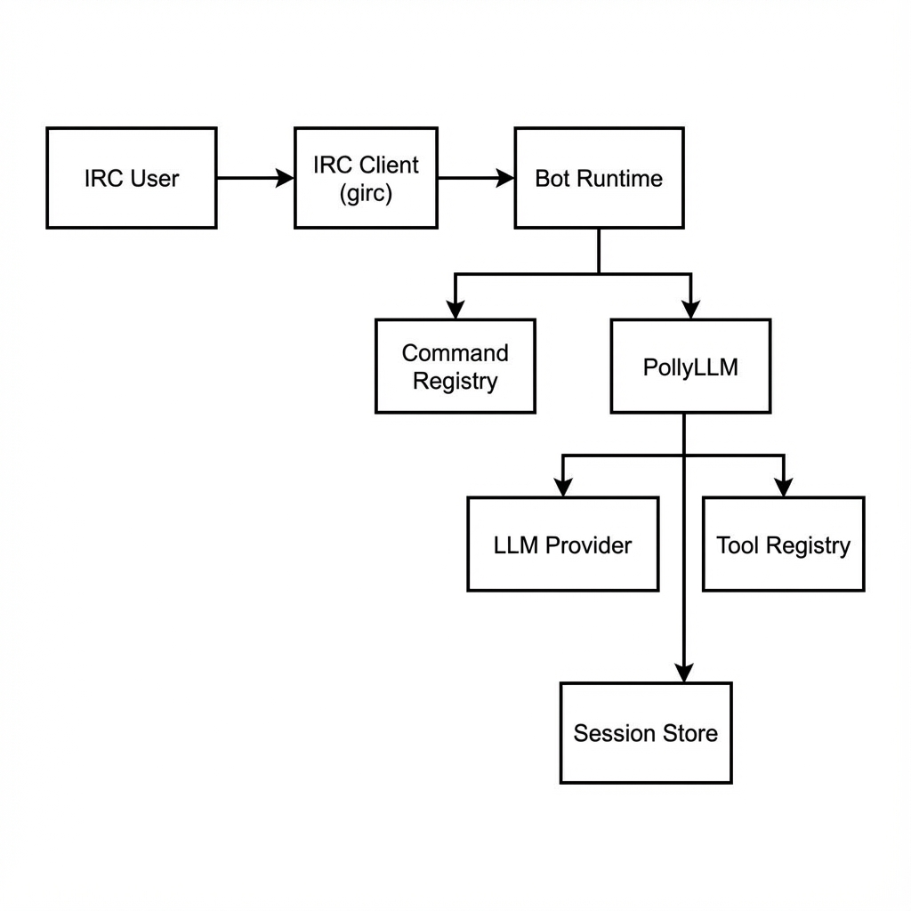

# Soulshack Architecture

## System Overview

Soulshack is an IRC bot designed to bridge traditional IRC chat with modern LLM capabilities. It uses a modular architecture to handle IRC events, manage conversations, and invoke LLM agents.

A key feature is its **Unified Tool System**, which abstracts differences between native Go tools, shell scripts, and MCP servers, allowing the LLM to use them interchangeably.

## Component Diagram

## Request Lifecycle

1.  **Event Reception**: A single `ALL_EVENTS` handler receives every IRC event from `girc`.
2.  **Early Exit**: The handler checks `Registry.Handles()` and drops events with no registered behaviors.
3.  **Context Creation**: A `ChatContext` is created, wrapping the event and configuration.
4.  **Behavior Dispatch**: The `Registry.Process()` method iterates registered behaviors for the event type. The first behavior whose `Check()` returns true wins — its `Execute()` runs and no further behaviors are evaluated.
5.  **Execution**:
    -   **Commands** (via `AddressedBehavior` / `NonAddressedBehavior`) are dispatched to the `CommandRegistry` or sent to the LLM.
    -   **Passive behaviors** (URL watcher, op watcher) call the LLM directly.
    -   **Lifecycle behaviors** (connected, nick/channel errors) handle join, retry, or fatal exit.

### Behavior Priority

Registration order in `run.go` determines priority (first-match-wins):

1.  Lifecycle: `Connected`, `NickError`, `ChannelError`
2.  Passive: `URL`, `Op`, `Join`
3.  Chat: `Addressed`, `NonAddressed`

For example, a non-addressed message containing a URL is handled by the URL behavior, not the non-addressed chat behavior.

## Key Interfaces

### `ChatContextInterface`
The primary interface passed to behaviors. It provides access to:
-   IRC operations (Reply, Join, Kick)
-   Configuration
-   User/Channel info
-   The conversation key: the channel, or the sender for private messages

### `Turn`
A `ChatContextInterface` plus its `Conversation`; what commands and completions get.
-   `core.WithConversation`: queues behind the key's running turn.
-   `core.WithDetachedConversation`: scratch conversation, discarded after.

### `System`
Holds the singleton components:
-   `ToolRegistry`: Manages available tools.
-   `Memory` (`internal/memory`): conversations, their artifacts, budget and expiry.
-   `Config` (`config.Store`): turns read a snapshot; `/set` doesn't block them.
-   `LLM`: The configured LLM client.

### Conversations
-   One pollytool session per key, leased to one turn at a time. Polly's agent is stateless across turns.
-   Stored in `--sessiondb` (SQLite) or in memory.
-   Idle past `--sessionduration`: restarts on next turn; sweeps use the current TTL. Named sessions have no storage TTL; scratch sessions do.
-   Transcripts are never trimmed. `maxcontext` is polly's `MaxContextTokens`: it clears read tool results, then summarizes, then fails. `read_transcript` still reaches summarized history.

Budget (`internal/llm/budget.go`):
-   Polly's floor (system prompt + tool schemas) is sent whole.
-   The incoming message gets up to half the remaining room (`messageShare`); the excess goes to an artifact.
-   `llm.MinContext` = floor + message floor + one page; smaller `maxcontext` is refused.
-   `contextFloor` mirrors polly's private estimate; a test keeps them in sync.
-   Detached turns and child agents get a scratch session (`Memory.WithScratch`) for artifacts.
-   A failed turn keeps its output and replies `Stopped:`.

### `LLM`
Abstracts the AI provider.
-   `ChatCompletionStream`: returns a `CompletionStream`. Drain `Chunks` before
    reading `Done`; error notices in `Chunks` don't mean success.
